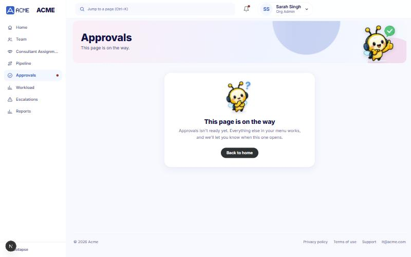
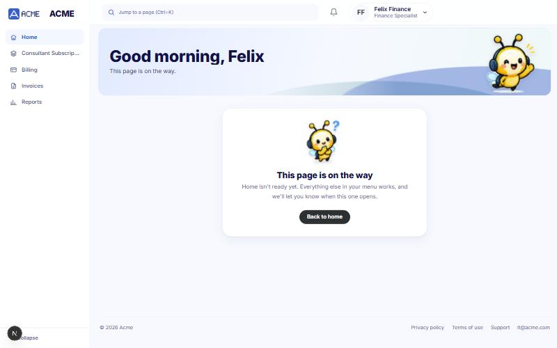

# HANDOFF — the remaining enterprise gaps (for the two developers building them)

> Written 2026-11-23 against `develop` at `a625c9b2`. Every item below was re-checked in the code that day.
> The short status list is [`enterprise-v2/BUILD-OUT-GAPS.md`](enterprise-v2/BUILD-OUT-GAPS.md). This file is the **how**: for each open item,
> what exists, what to build, which files to open first, how you know it is done, and what you need from the owner.
> All paths are from the repository root unless a link says otherwise.

---

## START HERE

**What you are building.** Kiwiply is a job-application product. The part you are finishing is *Enterprise*: each consultancy (an
"organization") gets its own branded site (`acme.kiwiply.com` or its own domain) with workspaces for its admins, marketers,
managers, consultants, HR and finance people. Most of it is built and live on `develop`. What is left is listed in
[§6](#6-the-items-one-card-each), split into two tracks so you can work side by side without touching the same files:

| | **Developer A — web + product track** | **Developer B — platform, security and ops track** |
|---|---|---|
| Mostly in | `web/` (Next.js) plus small API additions | `api/` (Spring Boot), `scripts/ops/`, the server |
| First task (small, gets you through the whole loop) | **Q1** — the tenant page title that says "Kiwiply" ([card](#q1-tenant-pages-without-their-own-title-say-kiwiply)) | **0.4** — reproduce the MySQL 9 migration failure ([card](#04-a-fresh-database-may-fail-to-migrate-on-mysql-92)) |
| Then | C6 Marketing Manager pages → C7 small gaps → A4 domain leftovers → C5 Executive overview → C4 Reports → C3 Integrations → C1 HR | D-6 break-glass → D-1 single sign-on → D-8 story suites → D4 / D9 real-world rehearsals → (with the owner) 0.3, D-7, D-4 on the server |

**First commands (both of you)** — ask the owner for access to the GitHub repository first:

```bash
git clone https://github.com/hasmika123/web-ext-job-application-autofill.git
cd web-ext-job-application-autofill
git checkout develop
npm ci                                  # at the ROOT: npm workspaces (packages/*, web, job-autofill)
cd web && npm run dev:demo              # the web app against a mock API, no database needed
# open http://acme.localhost:3000/login  — sign in as sarah@acme.com / demo1234 (password is the mock's, see web/scripts/mock-tenants.mjs)
```

Then read, in this order: [`CLAUDE.md`](../CLAUDE.md) (the house rules, 15 minutes), [§2 below](#2-rules-you-must-not-break), and the card for your first task.

**Who decides.** The owner (repo admin) merges every PR, answers the open product questions, holds the server and the cloud accounts,
and is the only one who promotes `develop` to `main` (that is a production deploy). Anything marked **🔑 owner** below needs them.

---

## 1. One-time setup

| Need | Detail |
|---|---|
| **Node** | Node 22 (what CI uses). `npm ci` at the repo root, never inside `web/` alone. |
| **Java 17** | The API needs JDK 17 exactly (a newer JDK on your PATH breaks Gradle). Set `JAVA_HOME` to it. |
| **Docker** | Needed for the API's integration tests (Testcontainers starts `mysql:9.2.0`) and for running MySQL locally. Set `TESTCONTAINERS_RYUK_DISABLED=true` if Ryuk fails to start. |
| **Run the API locally** | `docker compose -f api/src/main/docker/mysql.yml up -d` (MySQL 9.2 on 127.0.0.1:3306, empty root password), then `cd api && ./gradlew` (runs `bootRun` with the `dev` profile). Or `node scripts/dev/api-local.mjs --stub` for a stub AI provider. |
| **Web with no API** | `cd web && npm run dev:demo` → mock API on :8080 + Next on :3000. Tenant sites are `acme.localhost:3000` and `beta.localhost:3000`. |
| **Web against your local API** | `cd web && npm run dev` with `DOSSIER_API_URL` pointing at your API. |
| **Extension** | `cd job-autofill && npm run build` → load `.output/chrome-mv3` unpacked in Chrome. Tests: `npm test -w job-autofill`. |
| **Web tests** | `npm test -w web` (sync, typecheck, lint, then vitest). Running vitest or tsc directly? Run `node scripts/sync-parser-core.mjs` in `web/` once first. |
| **API tests** | Unit: `cd api && ./gradlew test`. Integration (Docker): `./gradlew integrationTest -x test --tests '*OrgDomainsIT*'`. Run one Gradle command at a time. |
| **Windows only** | If npm scripts fail with `spawn … ENOENT`, set `COMSPEC=C:\Windows\System32\cmd.exe` for that shell. |

**Mock sign-ins** (`web/scripts/mock-tenants.mjs`, password `demo1234`, all on `acme.localhost:3000`):

| Account | Role | Lands in |
|---|---|---|
| `owner@acme.com` | Owner | Admin workspace |
| `sarah@acme.com` | Org Admin + Marketing Manager | Admin, and `/w/marketing-mgmt` |
| `marketer@acme.com` | Marketing Specialist | `/w/marketing` |
| `consultant@acme.com` | Consultant | `/w/consultant` |
| `finance@acme.com` | Finance Specialist | `/w/finance` |
| `owner@beta.com` | Owner of the second org | `beta.localhost:3000` |

There is no HR or Executive person in the mock yet: C1 and C5 add one (`web/scripts/mock-me-tenant.mjs`, the `MEMBERS` list and
`MOCK_TENANT_USERS`). The mock's menus come straight from `api/src/main/resources/config/ent/workspaces.json`, so a new menu item
shows up in the mock with no extra work; new **data** needs a `web/scripts/mock-<area>.mjs` registered in `web/scripts/mock-api.mjs`
(see how `createMktMock` is wired).

---

## 2. Rules you must not break

These come from [`CLAUDE.md`](../CLAUDE.md). Reviews will send work back for any of them.

1. **Never submit an application for anyone.** No auto-submit, no CAPTCHA bypass, ever. Marketers and Kiwiply *prepare*; the consultant submits.
2. **No sensitive personal data.** Never ask for, accept, store, extract or send to AI: SSN/ITIN, bank or routing numbers, tax IDs,
   passport/visa/I-9/document numbers, date of birth. HR and Finance are **records only** (no identity documents) and **never move money**.
   Every free-text field goes through the PII scanner (`api/src/main/java/com/dossier/api/service/privacy/SensitiveContent.java`);
   `SensitiveTextCoverageTest` fails the build if a new free-text endpoint skips it.
3. **Organization sites show no Kiwiply.** Tenant pages, their emails, titles and notices name the organization, never Kiwiply.
4. **One design system.** Every icon, button, badge, card and token comes from `@kiwiply/ui` (`packages/ui`). Never inline an `<svg>`
   or hand-style a primitive in a page. A new shared visual goes into `packages/ui` first (`packages/ui/README.md`).
5. **Everything is admin-configured.** Limits, switches, prices, defaults: a setting in the registry (`EnterpriseSettingKeys.java`,
   `AdminSettingKeys.java`) with a safe default, never a hard-coded number.
6. **Database changes are additive.** New Liquibase changeset files only, registered in `master.xml`. No drops, renames or type changes
   (`LiquibaseAdditiveTest` and the deploy-time lint in `scripts/ops/lib.sh` refuse them). Never edit a changeset that already ran.
7. **Never commit secrets.** Keys come from environment variables only.
8. **Real ATS pages before selectors.** For extension work, capture the real page structure first; never guess a site's markup.
9. **The extension's engine stays plain JavaScript**, and new engine dependencies need the owner's OK. Bump the extension version
   (`job-autofill/wxt.config.ts` + `job-autofill/package.json`) whenever you change it.
10. **Enterprise UI rules** (from the Phase 1 refresh, `docs/enterprise-v2/ui-refresh/PHASE1-STRUCTURE-AND-CONTENT.md` §2):
    no bee "help" cards, no "Quick Actions" cards, no sparklines or up/down deltas on KPI tiles (except Dashboard, Reports, Performance),
    "Not scored" instead of 0%, subtitles of 12 words or fewer, US spelling, sentence case, no "Coming soon" rows, at most one SAMPLE chip
    per section. Some older design docs (e.g. `deferred/marketing-manager.md` §6) still show bee cards and deltas — **the Phase 1 rules win.**

---

## 3. How work flows

- **Branch off `develop`**, one branch per item: `git checkout -b ent-<item> origin/develop`. Never branch off `main`.
- **PR into `develop`**, never into `main`. The owner merges. Only the owner promotes `develop` → `main` (production deploy).
- **One item per PR.** Commit in slices if it helps review (API, then web + docs), but don't mix two items.
- **CI must be green** — 13 checks: extension tests, web typecheck + lint + build, web unit, web end-to-end (Playwright on `dev:demo`),
  web Docker image, ops scripts, API unit, six API integration shards, and the API gate. The end-to-end job sometimes flakes (one test
  fails, then the server hangs): re-run only the failed job (`gh run rerun <run-id> --failed`).
- **When an item is done,** in the same PR: tick its row in `docs/enterprise-v2/BUILD-OUT-GAPS.md` (✅ + one line on what was built),
  add one line under `## Log` in `PROGRESS.md` and in `docs/enterprise-v2/progress-tracker.md`, and update the design doc if you
  changed the plan. If you go off-spec or get stuck on a product question, stop and ask the owner rather than improvise.
- **Definition of done:** acceptance criteria met · tests added and green · docs and logs updated · extension version bumped if touched ·
  PR into `develop` with a clear description of what changed and what was not verified.

---

## 4. How the enterprise code fits together

### 4.1 The request path

```
browser on acme.kiwiply.com
  → web/src/proxy.ts            resolves the host to an organization, rewrites to the (tenant) tree, sets the surface header
  → web/src/app/(tenant)/%5Ft/** the tenant pages (server components)
  → web/src/app/api/orgs/[orgId]/**   the BFF ("backend for frontend") routes: shape checks only, then forward()
  → api  /api/orgs/{orgId}/**   Spring resources; the API resolves the tenant from the host alone and checks permissions
```

- **The API owns every rule.** The BFF only checks shape (`readObject`, `onlyFields`, `badBody` in `web/src/lib/admin-proxy.ts`) and
  forwards (`forward()`); Spring's error responses come back as `{error, code}` with the same status.
- **Permissions:** a resource method carries `@OrgPermissionRequired` (membership), then the service checks the specific key
  (e.g. `access.require(me, MANAGE)` in `OrgDomainService`). Keys live in `api/.../service/ent/authz/EntPermissions.java`.
  A handler with neither `@OrgPermissionRequired` nor `@OrgUnscoped` fails `OrgResourceGuardTest`; every new route also needs a row in
  `OrgIsolationIT.COVERAGE` (`api/src/test/.../web/rest/org/OrgIsolationIT.java`), which proves one organization can never read another's data.
- **Writes** take an `Idempotency-Key` header (`IdempotencyService`). **Audit** goes through `OrgAuditService.record(...)`.
  **Background jobs** lock with `JobLeaseService` (there is no ShedLock). **Org emails** follow `AccountOnboardingNotices.java`
  (`brandFor()` → `TenantMailBrand`, then `afterCommit(() -> mail.sendX(...))`) so they carry the organization's brand, not Kiwiply's.

### 4.2 How a menu item becomes a page

1. **The menu** is data: `api/src/main/resources/config/ent/workspaces.json`. Each workspace (`ADMIN`, `MARKETING`, `MARKETING_MGMT`,
   `CONSULTANT`, `HR`, `FINANCE`, `ACCOUNTS`, `EXEC`) has `nav[]` items with `key, label, icon, href, needs[], module?`. `needs` = the
   member must hold one of these permission keys; `module` hides the item while that module is off. `WorkspaceDefinitions.java` validates
   the file at start-up, and `WorkspaceDocSyncTest` keeps it in step with `docs/enterprise-v2/16-ui-ux-page-inventory.md` (change both).
2. **The browser gets the menu** from `GET /api/me/tenant` (`MeTenantResource.java`) via `web/src/lib/ent/tenant-session.ts`.
   `can(me, key)` in `web/src/lib/ent/workspaces.ts` answers "may this member see this".
3. **A URL becomes a page** in the catch-all `web/src/app/(tenant)/%5Ft/w/[workspace]/[[...slug]]/page.tsx`: it finds the menu item,
   asks a per-workspace registry (`marketingPageFor` in `components/ent/marketer-ws/registry.tsx`, `accountsPageFor` in
   `components/ent/accounts-ws/registry.tsx`) for a component, and **falls back to "This page is on the way"** (line 71). An item the member
   can't use shows "This isn't part of your role". A real folder such as `w/[workspace]/domains/page.tsx` always wins over the catch-all.

So: to build a placeholder page, either add a branch to that workspace's registry (the design docs ask for this for Marketing Manager
and Executive) or add a real page folder.

### 4.3 A complete example to copy

**The Domains page** is the best full example (API → page, with tests at every layer), in build order:

| Layer | File |
|---|---|
| Migration | `api/src/main/resources/config/liquibase/changelog/20261202010000_ent_custom_domains.xml` (+ `20261203010000_ent_domain_certs.xml`) |
| Entity / repository | `api/.../domain/ent/OrgHostname.java`, `api/.../repository/ent/OrgHostnameRepository.java` |
| Service + DTO records | `api/.../service/ent/domains/OrgDomainService.java` |
| Resource | `api/.../web/rest/ent/OrgDomainResource.java` (`/api/orgs/{orgId}/hostnames`) |
| BFF | `web/src/app/api/orgs/[orgId]/hostnames/[[...path]]/route.ts` + `web/src/lib/ent/domains-bff.ts` (one catch-all route with an allow-list) |
| Client lib | `web/src/lib/ent/domains.ts` |
| Component | `web/src/components/ent/domains/DomainsPage.tsx` |
| Route | `web/src/app/(tenant)/%5Ft/w/[workspace]/domains/page.tsx` |
| Tests | `HostnameVerifierTest`, `OrgDomainsIT`, `domains-bff.test.ts`, `domains.test.ts`, `DomainsPage.test.tsx` |

**A smaller one** (a panel inside an existing page, merged in PR #164): `MktCanonicalMatchesResource.java` →
`web/src/app/api/orgs/[orgId]/mkt/matches/canonical/**` → `web/src/lib/ent/marketer-ws/canonical-matches.ts` (strict `parseX` functions and
`{kind: "OK" | "DENIED" | "FAILED"}` results — copy this style) → `components/ent/marketer-ws/matches/CanonicalMatchesPanel.tsx`, with an
end-to-end journey in `web/e2e/journeys/tenant-canonical-matches.spec.ts`.

### 4.4 Tests, by kind

| Kind | Where / how | Example |
|---|---|---|
| API unit | `cd api && ./gradlew test` (excludes `*IT`) | `MktCanonicalMatchesServiceTest` |
| API integration | `./gradlew integrationTest -x test` — `@IntegrationTest`, Testcontainers `mysql:9.2.0`, needs Docker | `OrgDomainsIT`; two-org base class `MemberItSupport` |
| Cross-cutting guards | run with the integration tests | `OrgIsolationIT`, `SensitiveTextCoverageTest`, `NoSubmitSurfaceTest`, `WorkspaceDocSyncTest`, `DataMapIT` |
| Web unit / component | `npm test -w web` (vitest + jsdom), files `src/**/*.test.ts(x)` | `DomainsPage.test.tsx`; BFF routes mock `@/lib/api` |
| Web end-to-end | `npm run test:e2e -w web` (Playwright, starts `dev:demo`) | `web/e2e/journeys/tenant-canonical-matches.spec.ts` |
| Story suites | Playwright against the **real** stack (API + MySQL + a production web build) | `web/e2e/stories/admin/dashboard.story.ts` (see D-8) |

---

## 5. What to do first, and what is blocked

| Order | Developer A (web + product) | Developer B (platform, security, ops) |
|---|---|---|
| 1 | **Q1** tenant title (S) | **0.4** MySQL 9 migration (S–M) — must be settled before the next production promotion |
| 2 | **C6** Marketing Manager pages (M) | **D-6** break-glass support access (M) |
| 3 | **C7** small gaps — search, password reset, placements, vacation (S each; messaging needs a decision) | **D-1** single sign-on (L) — 🔑 owner approves the libraries first |
| 4 | **A4** domain leftovers (M) | **D-8** re-run the story suites (M) |
| 5 | **C5** Executive overview (M) | **D4** real-Gmail rehearsal, **D9** real Workday fill (S each) — 🔑 owner provides the Gmail account |
| 6 | **C4** Reports library (M) | **0.3 / D-7 / D-4** on the server — 🔑 owner gives server and cloud access, or does it with you |
| 7 | **C3** Integrations (L) | |
| 8 | **C1** HR (L) | |
| Blocked | **C2** Finance (waits on the timesheets design answers) · **A8** org terms (waits on the legal text) · **C8** UI refresh Phase 2 (a design pass) | |

Size: **S** under a day · **M** 1–3 days · **L** a week or more.

---

## 6. The items, one card each

Each card: **Now** (what exists) · **Build** · **Start here** (files to open first) · **Done when** · **Watch out** · **Needs** (from the owner).

### Q1. Tenant pages without their own title say "Kiwiply"

*Found while taking the screenshots for this handoff. Not on the gap list; it breaks rule 3.*

- **Now:** the root layout's title template is `"Kiwiply | %s"` (`web/src/app/layout.tsx:31`). The tenant layout sets
  `title: { template: "%s · Acme", default: "Acme" }` (`web/src/lib/tenant-metadata.ts:14`). In Next.js a layout's `default` is still wrapped
  by the parent's template, so any tenant page that sets no title of its own — e.g. the organization's home `/` — shows
  **"Kiwiply | Acme"** in the browser tab. (`web/src/app/(tenant)/%5Ft/not-found.tsx:13` already works around the same thing with `absolute`.)
- **Build:** make the tenant default title ignore the parent template (Next's `title.absolute` alongside `template`), so `/` reads "Acme"
  and child pages still read "Page · Acme".
- **Start here:** `web/src/lib/tenant-metadata.ts`, its test, `web/src/app/(tenant)/%5Ft/layout.tsx`.
- **Done when:** a test asserts the tenant metadata never produces "Kiwiply"; signing in on `acme.localhost:3000` shows "Acme" on `/`
  and "Dashboard · Acme" on `/w/admin`.

### C6. Marketing Manager workspace — 8 pages (the API is built)



*Today, signed in as `sarah@acme.com` on the mock: every Marketing Manager page shows "This page is on the way".*

- **Now:** the whole API exists and is tested (`api/src/main/java/com/dossier/api/web/rest/ent/mgmt/`, merged 2026-11-10 in PR #136).
  The web has **no BFF route, no client lib and no components** for it.

  | Page (`/w/marketing-mgmt/…`) | Permission | API it uses (`/api/orgs/{orgId}/mgmt/…`) |
  |---|---|---|
  | Home | `workload.view` | `GET /home` (tiles: marketers, consultants covered, open opportunities, approvals waiting, escalations by severity) |
  | Team | `member.view_summary` | `GET /team?q&status&sort`, `GET /team/{memberId}` (consultants, 8-week series, open items), `PATCH /team/{memberId}` |
  | Assignments | `assignments.manage` | `GET /assignments`, `GET /assignments/consultants/{id}/history`, `POST /assignments/{assign,update,unassign,restore}` |
  | Pipeline | `pipeline.view` | `GET /pipeline` (board, columns ASSIGNED → CLOSED), `GET /pipeline/summary` |
  | Approvals | `approvals.decide` | `GET /approvals?status&kind`, `GET /approvals/{id}`, `POST /approvals/{id}/approve` and `/reject` |
  | Workload | `workload.view` | `GET /workload`, `POST /workload/rebalance` |
  | Escalations | `escalations.manage` | `GET /escalations`, `/escalations/counts`, `/escalations/{id}`; `POST /escalations/{id}/{acknowledge,assign,snooze,resolve,dismiss,reopen,comment}` |
  | Reports | `reports.view` | `GET /reports/overview?range=30|90`, `GET /reports/export` (CSV) |

  Every write needs an `Idempotency-Key`. All pages except Team and Reports also need the `marketing` module on.
- **Build:** the design is `docs/enterprise-v2/deferred/marketing-manager.md` — §5 (API table), **§6 (one row per page: component, layout,
  actions)**, §8 (tests); stories MM-xx in `docs/enterprise-v2/deferred/stories.md`. In short:
  1. A catch-all BFF `web/src/app/api/orgs/[orgId]/mgmt/[[...path]]/route.ts` + `web/src/lib/ent/mgmt-bff.ts` with an allow-list, copied from
     `marketing-assignments/[[...path]]` + `web/src/lib/ent/marketing-assignments-bff.ts` (it already forwards `Idempotency-Key`).
  2. Client libs `web/src/lib/ent/mgmt-ws/*.ts` (parse functions per DTO).
  3. Components `web/src/components/ent/mgmt-ws/<page>/…` and a `registry.tsx` with `mgmtPageFor(me, slug)`, wired into the catch-all
     page next to `marketingPageFor`.
  4. A mock `web/scripts/mock-mgmt.mjs` so the pages work on `dev:demo`.
  5. Reports: reuse `components/ent/reports/ReportsPage.tsx` with a team scope (today it takes only `{orgId, orgName}` and
     `lib/ent/reports.ts` hard-codes `/reports/overview`; add a `basePath`).
- **Start here:** `deferred/marketing-manager.md` §6 → the DTOs in `api/.../service/ent/mgmt/` (`MgmtHomeDTO`, `MgmtPipelineDTO`,
  `MgmtAssignmentsDTO`, `TeamRowDTO`) and `api/.../service/ent/mkt/{approvals/ApprovalRequestDTO, escalations/EscalationDTO}` → the marketer
  workspace pages as visual models (`web/src/components/ent/marketer-ws/`).
- **Done when:** all 8 pages render real data for `sarah@acme.com` (mock) and against the real API; a member without the key gets
  "This isn't part of your role"; component + BFF tests per page; one end-to-end journey (e.g. approve a request); no page says "on the way".
- **Watch out:** the design doc's §6 still shows bee help cards, sparklines and delta chips — leave them out (rule 10). Managers never submit
  anything (`MgmtNeverSubmitsTest`).
- **Needs:** nothing; the design is decided (DD-1 to DD-3 in `docs/enterprise-v2/08-decisions-for-user.md`). Suggest one PR per 2–3 pages.

### C5. Executive overview workspace

- **Now:** the `EXEC` workspace (`workspaces.json`, Home + Reports; role `EXECUTIVE_VIEWER` in `RoleTemplates.java`) has no API and no page.
- **Build (decision DD-9):** the organization dashboard **projected to counts**, with a privacy floor: any group smaller than
  `org.analytics.k_min` (default 5, a new registry setting) is dropped, and per-person widgets are left out. Design:
  `docs/enterprise-v2/deferred/org-admin-pages.md` §5 (`?view=exec`, an `ExecProjection`, `ExecHomePage`, `execPageFor`); settings §3.4;
  stories EXE-xx in `deferred/stories.md`.
- **Start here:** `api/.../service/ent/dashboard/OrgDashboardService.java` (`get(me)`), `DashboardWidgetRegistry.java`,
  `DashboardWidgetProvider.java` and its providers; `OrgDashboardResource.java`; web `components/ent/dashboard/DashboardPage.tsx` and `parts.tsx`,
  `web/src/lib/ent/dashboard.ts`.
- **Done when:** an Executive Viewer sees counts only (no names), small groups are hidden below `k_min`, Reports opens the shared Reports page;
  tests for the projection (including the floor) and the page. Add an Executive person to the mock.
- **Watch out:** `FLAG_ANALYTICS` exists but is unenforced (`EnterpriseSettingKeys.java`) — decide with the owner whether it gates this.

### C7. Small gaps inside existing pages

Five separate small items. Each can be its own PR.

| Gap | Now | Build | Start here | Needs |
|---|---|---|---|---|
| **Search beyond page names** | The top search only finds menu pages (`components/ent/shell/ShellSearch.tsx`, `lib/ent/shell.ts` `searchPages`). | Quick search over employees, consultants, clients and jobs, each result only if the member's permissions allow it. Spec: `docs/enterprise-v2/16-ui-ux-page-inventory.md` lines 63–64 and `40-api-specs.md` (the `q` conventions). | `ShellSearch.tsx`; the list endpoints that already take `q` | — |
| **Admin password reset** | Works only while the member still has a temporary password; otherwise 409 `PASSWORD_ALREADY_SET` and they use Forgot password (`api/.../service/org/OrgAccountService.java` `reset`, ~164–188; `OrgMemberResource.java` `POST /{memberId}/reset-password`; web `components/ent/employees/DetailSheet.tsx`). | Either allow a reset for any member (send a reset link, never show a password), or confirm with the owner that Forgot password is enough and close the item. | `OrgAccountService.java`, `MailService.sendAdminPasswordResetEmail`, `DetailSheet.tsx` | 🔑 which of the two |
| **Placement milestones and resources** | Sample data only: the API sends a `sample` flag (`ConsultantPlacementDTO.java`), rows come from `ConsultantWsPlacementDemoSeeder`; the page marks them as stand-ins (`components/ent/consultant-ws/PlacementsPage.tsx`). | Let the organization (admin/ops) write milestones and meetings; make "Helpful resources" admin-configured links. Spec: `docs/enterprise-v2/page-consultant-placements.md` "Known gaps". | `PlacementsPage.tsx`, `ConsultantPlacementResource.java`, table `cws_placement_milestone` | — |
| **Vacation approval** | A consultant's vacation starts PENDING and nothing approves it (`components/ent/consultant-ws/AvailabilitySheets.tsx` ~148, `ConsultantAvailabilityService.java`; rule in `docs/enterprise-v2/page-consultant-availability.md`). | A marketer/manager approval and a notice back to the consultant. The likely fit is a new kind in the existing approvals (`mkt_approval_request`, decided by managers in C6). | `AvailabilitySheets.tsx`, the approvals service | 🔑 who approves |
| **"Message your marketer"** | Send message / Schedule call / View calendar are disabled with an explanation (`components/ent/consultant-ws/MarketerPage.tsx`); messages are sample data from `ConsultantMarketerService.java`. | Consultant ↔ marketer messaging. **There is no design for it yet.** | `MarketerPage.tsx`, `docs/enterprise-v2/page-consultant-marketer.md` | 🔑 a short design first (scope, notifications, retention, PII scanner on every message) |

### A4. Custom-domain leftovers

Custom domains themselves are built (add, verify, certificate, live, suspend, remove). Three things are left
(`docs/enterprise-v2/CUSTOM-DOMAINS-BUILD.md` lines ~88–91):

1. **Redirect other addresses to the main one.** Spec: `docs/enterprise-v2/10-domain-routing.md` §6 and its settings table
   (`org.domains.redirect_non_primary`, default true; `org.domains.subdomain_mode`) — neither setting exists yet. Hook point:
   `tenantRequest()` in `web/src/proxy.ts`, after the "served" check. The public tenant lookup (`PublicTenantDTO.java`) needs the
   `primaryHost` and `redirect` fields the doc describes (its existing `primary` field is a brand colour, not a host). Story DOM-04 in
   `deferred/custom-domains.md`. Keep sign-in and `/.well-known/*` paths working on every host.
2. **Proxy and CAA diagnostics.** Today the page shows one fixed sentence ("keep the records DNS-only", `OrgDomainService.java:147`).
   Build a real check: spot a proxied record (e.g. Cloudflare's orange cloud) and read CAA records that would block the certificate, with a
   specific hint for each. Spec: `10-domain-routing.md` §4.2 and the error copy below it. Code: `HostnameVerifier.java` (lists today's codes),
   `DnsLookup.java`; web `checkText()` in `web/src/lib/ent/domains.ts`.
3. **Failure notifications.** `HostnameProbeJob.java` and `HostnameCheckJob.java` only log. Notify the members holding `domains.manage`
   when verification or the certificate fails (in-app, plus email with the organization's brand). Models: `EscalationNotices.java`
   (in-app notice to everyone with a permission, with de-duplication), `AccountOnboardingNotices.java` (branded org email),
   `DashboardAlertService.java` (already shows DOMAIN_FAILING on the dashboard).

- **Done when:** each of the three has tests (unit for the verifier/redirect logic, `OrgDomainsIT` cases, `proxy` tests), and
  `CUSTOM-DOMAINS-BUILD.md` lists them as built.
- **Watch out:** the server's edge (Caddy) is shared with another product; this work changes no server config.

### C4. Reports beyond the 30/90-day overview

- **Now:** `OrgReportsResource.java` (`GET /overview?range=30|90`, `GET /export`), `OrgReportsService`, web
  `components/ent/reports/ReportsPage.tsx` (Admin workspace only). The tables `report_definition`, `report_metric`, `report_recipient`,
  `report_run`, `report_export` exist but nothing uses them.
- **Build (DD-7):** `docs/enterprise-v2/deferred/org-admin-pages.md` §3 — a `ReportSource` registry, a report library with run endpoints,
  tabs Overview · Library · Exports, and a `ReportScheduleJob` that posts an **in-app notice only** (never emails files). CSV only.
  `reports.export` doubles as the "manage" permission. Stories REP-xx in `deferred/stories.md`. Also render Reports in the other workspaces
  that list it (Marketing Manager, Finance, HR, Executive).
- **Done when:** a saved report runs on demand and on schedule, its CSV downloads, and each workspace's Reports page works with its scope.

### C3. Integrations — webhooks and CSV import/export

- **Now:** only the consultant CSV import (onboarding) and a few CSV exports exist. **No outbound webhooks** ("webhook" in the code today
  means Stripe's inbound one), no Integrations page, no workspace menu item; `FLAG_INTEGRATIONS` is a placeholder.
- **Build (DD-8, scope decided):** outbound webhooks + two-phase CSV import/export of consultants and requirements. **No OAuth, no Google API,
  no inbound API keys, no third-party sync.** Design: `deferred/org-admin-pages.md` §4 (tables `org_webhook`, `org_webhook_delivery`,
  `org_import_job`; the event catalogue; HMAC signatures; `WebhookDeliveryJob` with retries) and `40-api-specs.md` §9.2.
- **Start here — copy:** `api/.../service/ent/consultants/ConsultantImportService.java` (browser parses the CSV, the server checks each row,
  then applies) + `web/src/lib/ent/consultant-import.ts` + `components/ent/consultants/ImportConsultantsSheet.tsx`; CSV safety in
  `api/.../service/ent/export/CsvSafe.java`; secret storage in `api/.../service/inbox/SecretBox.java`; job locking `JobLeaseService`.
- **Watch out:** **a URL guard (SSRF) must be written** — webhooks must refuse private, loopback and link-local addresses and re-check after
  DNS resolution. Payloads must pass the PII rules (no sensitive fields ever leave).
- **Done when:** an admin adds a webhook, sees signed deliveries with retries and a delivery log, and imports/exports consultants and
  requirements in two steps (check, then apply); `OrgIsolationIT` rows for every new route.

### C1. HR workspace (records only)

- **Now:** tables, entities, repositories and demo seed data (`20261101010000_ent_ops_data.xml`; `api/.../domain/ent/ops/Hr*`;
  `OpsDemoSeeder.seedHr`). **No API**; the HR pages (employees, onboarding, documents, compliance, lifecycle, offboarding, candidates,
  talent pools, reports) show "on the way". Module `hrFinance`; keys `hr.view`, `hr.manage`, `lifecycle.manage`, `onboarding.coordinate`.
- **Build:** `docs/enterprise-v2/deferred/org-admin-pages.md` §0 (the E2 rules) and §1 (lifecycle state machine §1.2, endpoint table §1.3,
  a new additive migration, `HrReminderJob`, settings §1.5); `36-hr-and-finance.md` §1 and §5; decisions DD-4 (the built tables win over
  doc 36) and DD-5 (document types are status-only labels: "received / missing", never a number, file or date). Stories HR-xx. Turn
  `FLAG_HR_FINANCE` from a placeholder into a live flag.
- **Watch out:** this is where rule 2 bites hardest. No identity documents, no ID numbers, no dates of birth, no file uploads of IDs.
  Every free-text field through `SensitiveContent`. The design mentions a `@NoSensitiveText` annotation that does not exist yet — story HR-01
  creates it. Add an HR person to the mock.
- **Done when:** HR pages work end to end on real data with the scanner on every text field, and `SensitiveTextCoverageTest` passes.

### C2. Finance / timesheets (records only) — 🔑 blocked

- **Now:** tables, entities and seed only (`Finance*` in `api/.../domain/ent/ops/`). The Finance menu shows only Home (on the way),
  Consultant Subscriptions, Billing, Invoices and Reports; Timesheets, Approvals, Payments and Placements stay hidden behind the
  operations module.

  

- **Build (when unblocked):** `deferred/org-admin-pages.md` §2 (endpoint table §2.2, a `finance_event` table, `FinanceOverdueJob`,
  `FinanceVerbsTest`), DD-6 (timesheets are the monthly `finance_timesheet` records). **Record money, never move it.**
- **Needs:** the owner's answers to the timesheets design questions (`docs/TIMESHEETS-DECISIONS.md`, `docs/HANDOFF-TIMESHEETS.md`).
  Don't start until they are answered.

### C8. UI refresh, Phase 2 (visuals) — design pass

- **Now:** Phase 1 (structure and wording) merged 2026-11-10. Phase 2 not started.
- **Scope** (`docs/enterprise-v2/ui-refresh/PHASE1-STRUCTURE-AND-CONTENT.md` ~line 459): tile and card styling, hero band art and height,
  sidebar width and density, fonts, colours, the Dashboard donut legend wrapping, table column widths, truncated labels in rail cards,
  dark theme. All through `@kiwiply/ui` tokens and primitives (rule 4), keeping the Phase 1 rules (rule 10).
- **Needs:** 🔑 the owner's visual direction before any code.

### A8. Organization terms / data processing agreement — 🔑 blocked on legal text

- **Now:** creating an organization (`AdminOrgDTOs.CreateRequest`, `AdminOrgResource` `POST /api/admin/orgs` → `AdminOrgService.create`;
  web `components/admin-v3/organizations/CreateOrganizationDialog.tsx`) records no terms. Personal accounts already record theirs
  (`api/.../service/privacy/TermsAcceptanceService.java`, table `terms_acceptance`).
- **Build:** a versioned org-level acceptance (who accepted, which version, when) at creation or the owner's first sign-in, modelled on
  `TermsAcceptanceService` (versions come from admin settings); show the organization's agreement version in the admin page.
- **Needs:** the legal text and the decision of *when* it is accepted.

### 0.4. A fresh database may fail to migrate on MySQL 9.2

- **Now:** the local demo runs `SET GLOBAL restrict_fk_on_non_standard_key = OFF` on every start because six foreign keys onto
  `hr_employee(org_id, id)` were refused (`20261101010000_ent_ops_data.xml`: `fk_hr_employee_note_employee` and five more, lines ~81–214).
  **But:** the unique key `uk_hr_employee_org_id (org_id, id)` already exists (line 54), and CI runs the whole changelog on `mysql:9.2.0`
  and passes. So the failure may only appear with the **production server flags**, or not at all. Production runs `mysql:9.2.0`
  (`docker-compose.prod.yml`) and has not applied these changesets yet — the next promotion will.
- **Build:**
  1. Reproduce with the production flags:
     ```bash
     docker run --rm -d --name fk-repro -e MYSQL_ROOT_PASSWORD=repro -e MYSQL_DATABASE=dossierApi -p 127.0.0.1:34611:3306 \
       mysql:9.2.0 mysqld --lower_case_table_names=1 --skip-mysqlx --character_set_server=utf8mb4 --explicit_defaults_for_timestamp
     # then, from api/:
     SPRING_DATASOURCE_URL='jdbc:mysql://127.0.0.1:34611/dossierApi?useSSL=false&allowPublicKeyRetrieval=true&createDatabaseIfNotExist=true' \
       SPRING_DATASOURCE_PASSWORD=repro APPLICATION_LIQUIBASE_ASYNC_START=false SERVER_PORT=18291 ./gradlew bootRun
     ```
     Note the first failing changeset and the exact MySQL error; run `SHOW INDEX FROM hr_employee`.
  2. A guess to test (not confirmed): the single-column foreign key on `org_id` (line 49) is created before the unique key, and MySQL may pick
     its index (which silently carries the primary key) as the parent key, which the strict check refuses.
  3. Fix with a **new, additive, precondition-guarded changeset** that runs before `ent-ops-2` (the existing changesets have run on
     dev/demo databases, so editing them breaks checksums there). `LiquibaseAdditiveTest` lists what is forbidden (all drops, renames,
     type changes, raw `drop`/`modify` SQL) and requires `MARK_RAN` preconditions.
  4. If it does **not** reproduce: write that down in `docs/enterprise-v2/demo/DEMO-PLAN.md` (its "has no unique key" note is wrong),
     remove the demo workaround, and close the item.
- **Done when:** a fresh `mysql:9.2.0` with the production flags migrates cleanly with the strict setting ON, CI covers those flags
  (add them to `MysqlTestContainer.java` if they matter), and the demo no longer needs the workaround.

### D-6. Break-glass support access (audited)

- **Now:** only an unenforced setting `admin.support_access_hours` (`AdminSettingKeys.java`). Two designs exist:
  - **Organization break-glass (build this first):** X6.17 in `docs/enterprise-v2/07-backlog.md` (lines ~3940–3989), threat T9 in
    `42-threat-model.md` §3.9, decision E8. `POST /api/admin/orgs/{id}/break-glass {reason (20+ characters), mfaCode}` creates a
    **15-minute read grant** over an allow-listed set of views (`BreakGlassProjections`); every read writes a HIGH/CRITICAL `ADMIN_READ` row to the
    organization's own audit log and the admin audit, and notifies the organization's owner.
  - **Personal "view as"** (later): `docs/design/admin/rbac-audit-mfa-impersonation.md` D5/D7 — the user grants 24 h read-only access.
- **Start here:** `AdminMfaService.java` (admin MFA is **off by default**: `dossier.admin.mfa-enabled`), `OrgAuditService.record(...)`
  (risk `CRITICAL` is reserved for this), `AdminAuditService.java`, `AdminOrgResource.java`, `TenantTokenBindingFilter.java` (admin tokens
  without a `tid` get 404 on `/api/orgs/**` — keep break-glass reads under `/api/admin/orgs/{id}/read/*`).
- **Watch out:** the backlog's notice text says "Kiwiply support accessed your workspace" — reword it ("Platform support"), rule 3.
  Use a new changelog timestamp after `20261210010000` (the planned name is out of order now).
- **Needs:** 🔑 turn admin MFA on in production (or decide another second factor) — break-glass without MFA defeats the point.
- **Done when:** a grant needs reason + MFA, expires after 15 minutes, every read is audited in both logs, the owner is notified, and tests
  prove a read without a live grant is refused.

### D-1. Single sign-on per organization (and stronger second factors)

- **Now:** none. The login page has a Microsoft button slot (`BrandedLogin.tsx`) linking to `/sso/microsoft`, but **no `/sso` route exists**
  and `PublicTenantService` hard-codes `google=false, microsoft=false`. Since 2026-11-19 an organization can require an emailed sign-in code
  (`OrgTwoStepService.java`, `AuthenticateController.java`) — SSO must coexist with it.
- **Build:** X12.4 in `07-backlog.md` (lines ~6535–6579): an `org_sso_connection` (SAML 2.0 or OIDC) per organization with a domain
  claim proven by a DNS TXT record, sign-in started from our side only, the identity must match an ACTIVE member (else `NOT_A_MEMBER`),
  "enforce" hides password and Google sign-in **but the owner keeps password sign-in as break-glass**. Then X12.10 (just-in-time member
  mapping) and X12.11 (TOTP and passkeys, lines ~6491–6534). Threats T34, T63 (Spring Security SAML2/OIDC only, no hand-rolled XML), T64
  (library review). Sessions stay one per host (`12-identity.md` §9).
- **Needs:** 🔑 the owner approves the libraries (Spring Security SAML2/OIDC, a WebAuthn library) before you add them, and decides whether an
  SSO sign-in counts as the organization's second step.
- **Done when:** an organization connects Microsoft Entra or Google Workspace, its members sign in through it on the organization's own
  address only, enforcement works with the owner's break-glass, and isolation tests prove one organization's IdP can't sign anyone into another.

### D-8. Re-run the story suites and re-record the videos

- **Now:** last full run 2026-10-18: 101 passed, 19 failed, 2 skipped. The 19 were never listed by name — only by kind (13 stale setup,
  2 slow under load, 1 locator clash, 1 real bug since fixed; PLT-05, PLT-10, PLT-12 are known stale ones). Not re-run since.
- **Run:** the real stack, not the mock — MySQL, the API on :18183 with `DEMO_ENABLED=true ENT_DEMO_SEED=true DEMO_ALLOW_WRITES=true
  APPLICATION_LIQUIBASE_ASYNC_START=false` plus the tenant-host secret, inbox key and storage settings, and a production web build
  (`npm run build -w web`, then `next start -p 3200`). Full recipe: `docs/enterprise-v2/real-stack-runbook.md` and `docs/enterprise-v2/qa/00-README.md` §3.1. Then from `web/`:
  ```bash
  STORY_WORKERS=1 STORY_VIDEO=off E2E_REAL_PORT=3200 PW_CHANNEL=chrome npx playwright test -c playwright.stories.config.ts e2e/stories/admin
  ```
  (repeat for `consultant`, `marketing`, `platform`). Reports land in `web/playwright-report-stories/`. Sign-in is rate-limited
  (10 per 5 minutes): restart `next start` to reset it.
- **Then:** fix stale tests (update the test) and real failures (fix the code, separate PR); re-record the videos with
  `playwright.videos.config.ts` + `node scripts/story-video/render.cjs` (`docs/HANDOFF-ENT-STORY-VIDEOS.md` §6,
  `docs/enterprise-v2/qa/videos-index.md`). Never commit the outputs.
- **Done when:** the suites are green, the result is written in `docs/enterprise-v2/demo/DEMO-PLAN.md`, and `videos-index.md` points at the new videos.

### D4. Real-Gmail inbox rehearsal — 🔑 needs a Gmail account

- **Now:** the inbox works against a sample mailbox; a real Gmail was never run. The key runbook exists (`DEPLOY.md`, inbox-key section;
  `docs/ops/secrets-rotation.md`) and so does the script: `docs/enterprise-v2/qa/REAL-GMAIL-DEMO.md`.
- **Do:** follow that script — API with `DOSSIER_DEMO_INBOX_SANDBOX=false`, a dedicated Gmail with 2-Step Verification and an App Password,
  send the 6 scripted mails, connect as the consultant, check the results, confirm other people see nothing, then disconnect and revoke the
  App Password. Check what reaches the marketer's board under each sharing level (`DataShareService.scopeOf`: NONE / SUMMARY / FULL).
- **Rules:** IMAP + App Password only; we never send, move or delete mail; headers and body text only, never attachments.
- **Done when:** the result is written into `REAL-GMAIL-DEMO.md` (date, what matched, what didn't), with fixes filed as their own PRs.

### D9. Autopilot on a real Workday posting

- **Now:** only step 1 of Workday's multi-step form was checked live; steps 2–4 are unit-tested (`docs/design/ext/ats-coverage-strategy.md`
  ~line 54, `MANUAL-QA.md` ~line 144). Adapter: `job-autofill/src/content/adapters/workday.js`; its "next" button logic never treats
  Submit/Apply/Finish as next (guarded by `job-autofill/test/no_submit.test.js`).
- **Do:** build and load the extension, open a real `*.myworkdayjobs.com` posting on two different companies, run the fill through every
  step **up to, never past, the final submit**, and record what filled, what didn't and why. **Never submit.** Fix gaps from the real page
  structure (rule 8); new fixtures must be scrubbed (`job-autofill/scripts/fixture-scrub.js`, a synthetic person only; see `job-autofill/test/fixtures/README.md`) and replay at 100%.
- **Done when:** `MANUAL-QA.md` is ticked with the date and both tenants, and any fixes are merged with a version bump.

### 0.3 / D-7 / D-4. Backups, database hardening, monitoring — 🔑 needs the server and cloud accounts

These three are setup on the production server, not code. The scripts and runbooks are written; **nothing shows they were set up.**
Do them with the owner (or the owner gives you access). Two warnings first:

> ⚠️ The server is **shared with another product (BeeCompete)**. Its edge proxy owns ports 80/443. Never start our Caddy, never touch
> those ports or the other product's containers or crontabs, never restart Docker. Always use
> `docker compose -f docker-compose.prod.yml -f docker-compose.shared-edge.yml`. (`DEPLOY.md` §1–§5, `docker-compose.shared-edge.yml`.)
>
> ⚠️ Most of the newer ops scripts (`ship-binlogs.sh`, `restore-drill.sh`, `install-cron.sh`, `host-guard.sh`) reach the server only with the
> next `develop` → `main` promotion. Plan the setup right after it.

- **0.3 Backups** (`DEPLOY.md` §5.1, ~lines 174–241): create the S3 bucket `kiwiply-db-backups` (public access blocked, versioning on,
  encryption on) and apply `scripts/ops/aws/lifecycle.json`; create the IAM user `kiwiply-backup` with only
  `scripts/ops/aws/backup-user-policy.json`; fill the `BACKUP_*` and `HC_*` variables in the server's `.env`; run
  `scripts/ops/install-cron.sh --dry-run`, then for real; run `scripts/ops/backup-db.sh` and `scripts/ops/verify-restore.sh` by hand once;
  do the restore drill (`scripts/ops/restore-drill.sh`, `DEPLOY.md` §5.10) and write the result in `DEPLOY.md`. Then tick 15.1c in `PROGRESS.md`.
- **D-7 Database hardening:** the API connects as **root** today (`docker-compose.prod.yml`, `application-prod.yml`). The code already
  supports a separate migration user (`LiquibaseConfiguration.java` reads `SPRING_LIQUIBASE_USER` / `SPRING_LIQUIBASE_PASSWORD`). Create
  `kiwiply_migrate` (schema rights) and `kiwiply_app` (`SELECT, INSERT, UPDATE, DELETE` on `dossierApi.*` — the app needs nothing else) and
  switch the API to them; test on a scratch database first. Keep root for the backup scripts. Point-in-time recovery: `DEPLOY.md` §5.9
  (binlog shipping + recovery). Turn on S3 versioning for the backup bucket and the resume bucket.
- **D-4 Monitoring:** the monitors are defined in `docs/ops/monitors.md` + `docs/ops/monitors.json` (UptimeRobot for the site, `www` redirect
  and API health; Healthchecks.io for backups, uploads, binlogs, host, drills and deploys). Create the accounts and checks, fill the alert
  emails, fill the people in `docs/ops/incident-runbook.md` §1 (all placeholders today), and publish a status page (the design picked the
  monitor vendor's hosted page at `status.kiwiply.com`: `docs/design/plat/monitoring-alerting-status-page.md`). The server-error email digest
  already exists (`ErrorDigestService.java`; set `DOSSIER_ERROR_DIGEST_TO`).
- **Done when:** a nightly dump lands in S3 and a drill restores it, alerts reach a person, the API runs without root, and `DEPLOY.md` records
  each step with its date.

---

## 7. What only the owner can do or decide

| Item | What |
|---|---|
| Promotion | `develop` → `main` is a production deploy. Before it: a database dump copied off the server, a migration review (0.4!), production flags off. |
| A5 | Apply the edge Caddy change for custom domains on the shared server. |
| B5 | Publish catalog prices after the margin review. |
| A8 | The organization terms / DPA text, and when it is accepted. |
| C2 | Answer the timesheets design questions. |
| C7 | Admin password reset scope; who approves vacation; a messaging design. |
| C8 | Visual direction for Phase 2. |
| D-1 | Approve the SSO / WebAuthn libraries; does SSO count as the second step. |
| D-6 | Turn admin MFA on in production. |
| D4 | A dedicated Gmail account for the rehearsal. |
| 0.3 / D-7 / D-4 | Server and cloud access (AWS, Healthchecks, UptimeRobot), or do them together. |
| Open decisions | Product questions D1, D3, D4, D6, D7 and separate-account questions O4 Q1–Q5 in `docs/enterprise-v2/08-decisions-for-user.md` and `19-separate-enterprise-accounts.md` §9 still run on their safe defaults. |

---

## 8. Words you will see

| Word | Means |
|---|---|
| Organization / tenant / org | One consultancy. Its site is a *tenant host* (`acme.kiwiply.com` or its own domain). |
| Workspace | A role's area inside the tenant site (`/w/admin`, `/w/marketing`, `/w/marketing-mgmt`, `/w/consultant`, `/w/hr`, `/w/finance`, `/w/exec`). |
| Consultant | The job seeker the organization places. **Marketer** finds and prepares jobs for them. **Marketing Manager** runs a team of marketers. |
| Prepare / Autopilot | Filling an application in the consultant's own browser, stopping before submit. Never submitting. |
| Licence / add-on | What a consultant may use (AI, inbox, Autopilot); billed to the organization. `EntitlementService` is the one gate. |
| BFF | The web's own API routes (`web/src/app/api/**`) that forward to the Spring API. |
| `tid` | The organization id inside a tenant session token; a session works only on its own organization's host. |
| Module | An organization-level switch that hides a group of pages (`marketing`, `hrFinance`, …). |
| Mock / `dev:demo` | The web app against a fake API (`web/scripts/mock-*.mjs`). Real stack = Spring API + MySQL. |
| Story suites | Long Playwright scripts that walk real user stories on the real stack (`web/e2e/stories/**`). |
| E2 | The rule that HR and Finance are records only: no identity documents, never moving money. |
