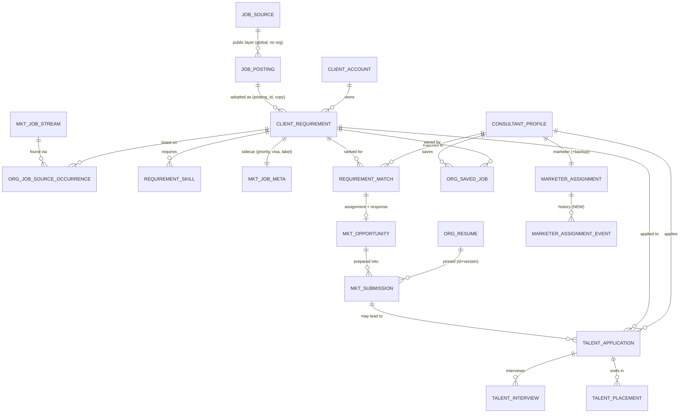

# 51 — Job domain model / ERD (DESIGN, proposal)

> Implements ADR-024. **Everything marked NEW or +col is a proposal; nothing exists yet.** Existing tables keep their names; all changes are additive (nullable or defaulted columns, new tables). Rules for every new table: `docs/enterprise-v2/41-database-design.md` R1–R10 (org_id NOT NULL + FK organization, org_id-first indexes, composite tenant FKs `(org_id, parent_id)` to the parent's `uk_<t>_org_id`, varchar enum names, DATETIME(6) UTC, precondition-guarded changeSets, no sensitive PII), repositories extend bare `Repository` with `orgId` first (`EntRepositoryContractTest`).

## 1. Conceptual picture

Key rule: **the line from `JOB_POSTING` to `CLIENT_REQUIREMENT` is the only edge that crosses the global/tenant boundary, it is copy-on-adopt, and there is no FK from a tenant table to a global table.**

## 2. Entities: existing, changes, new

### 2.1 Job Opportunity — `client_requirement` (existing, V `ent_talent.xml:179-213`)
| Responsibility (from the brief's attribute list) | Status |
|---|---|
| id, title, description_text, client_id (+ contact), location, work_mode, employment_label, duration_label, experience_level, rate_min/max_minor + rate_unit + currency, positions/filled, status (OPEN/IN_REVIEW/ON_HOLD/FILLED/CLOSED), posted_at, closed_at, owner_member_id, source, created/updated | **exists** |
| Required skills (+ order) | exists: `requirement_skill` (`org_id,requirement_id,skill,sort_order`; unique per skill) |
| Priority, visa label, source *label* | exists as sidecar `mkt_job_meta` (free text `source_label`) |
| **+col** `posting_id BIGINT NULL` (global `job_posting.id`, no FK) | adopt link |
| **+col** `external_id VARCHAR(100) NULL`, `url VARCHAR(1000) NULL`, `apply_url VARCHAR(1000) NULL` (primary occurrence mirror, denormalised for list views) | provenance |
| **+col** `first_seen_at`, `last_seen_at DATETIME(6) NULL`, `closing_date DATE NULL`, `closed_reason VARCHAR(30) NULL` (SOURCE_GONE/FILLED/CLIENT_CANCELLED/EXPIRED/MANUAL) | lifecycle |
| **+col** `dedup_key CHAR(64) NULL` (SHA-256 of normalised client\|title\|location\|work_mode), index `(org_id, dedup_key)` — **not unique** | merge suggestion |
| **+col** `field_overrides VARCHAR(1000) NULL` (JSON list of fields an org edited; stops source sync from overwriting them) | adopt sync |
| **+col** `preferred_skills` → new rows in `requirement_skill` with **+col** `kind VARCHAR(10) DEFAULT 'REQUIRED'` (REQUIRED/PREFERRED) | skills |
| **+col** `work_authorization VARCHAR(120) NULL` (text requirement, e.g. "US citizen / GC / H1B transfer"), `version BIGINT` (`@Version`) | hard-eligibility, locking |
| Normalisation: company = `client_account` (already normalised, unique `name_key`); skills = rows (free-text `skill`, case-insensitive compare via a `skill_key` generated column **proposed**); location/compensation stay as columns (not normalised: demo-scale, matching uses simple contains; revisit with a `location` dictionary only if needed) | decision |
| History of changing job details | **NEW** `org_job_change_event(org_id, requirement_id, changed_at, changed_by_member_id NULL, source ENUM(MEMBER|SOURCE_SYNC), changes JSON)` append-only; written by update service and the adopt-sync |

### 2.2 `org_job_source_occurrence` (NEW) — Job Source vs Job identity
`id, org_id, requirement_id (composite FK), stream_id NULL (composite FK mkt_job_stream), source_label VARCHAR(60), external_id VARCHAR(100) NULL, url, apply_url, first_seen_at, last_seen_at, status ACTIVE|MISSING|EXPIRED, payload_hash CHAR(64) NULL, raw_payload MEDIUMTEXT NULL (kept N days, setting; public fields only), created_at`.
Unique `(org_id, stream_id, external_id)` where both not null (generated key). Index `(org_id, requirement_id)`, `(org_id, status, last_seen_at)`.
Rules: a source update only touches this row and, when the hash changed, the job's non-overridden fields (writes an `org_job_change_event`). A listing that disappears becomes `MISSING` after one missed sync, `EXPIRED` after N days; the **job** is `CLOSED/SOURCE_GONE` only when no `ACTIVE` occurrence remains (setting `jobs.source_gone_days`, default 7). Conflicting source data: the highest-priority occurrence (stream priority) wins for non-overridden fields; the others are retained as provenance.

### 2.3 `org_saved_job` (NEW)
`id, org_id, consultant_id (composite FK), requirement_id (composite FK), saved_at, note VARCHAR(300) NULL`; unique `(org_id, consultant_id, requirement_id)`. Consultant-OWN only (`con` namespace). Not shared with marketers unless the consultant shares (setting; default private).

### 2.4 ConsultantJobMatch — `requirement_match` (existing, V `ent_talent.xml:236-256`, `LQ/20261104040000_mkt_opportunities.xml:18-21`)
Existing: `org_id, requirement_id, consultant_id, score int, reason(300), source RULE|MANUAL, status SUGGESTED|ASSIGNED|DISMISSED, assigned_by_member_id, assigned_at, created_at`; unique pair, unique `(org,id)`.
Proposed **+cols**: `skills_score, experience_score, location_score, availability_score, auth_score` (TINYINT NULL each; the five components of the brief); `preferences_score TINYINT NULL`; `missing_skills VARCHAR(500) NULL` (comma list); `explanation JSON/VARCHAR(2000) NULL` (structured reasons: matched skills, gaps, ticks) replacing the free 300-char `reason` for UI (keep `reason` as the short line); `hard_eligible BOOLEAN DEFAULT TRUE`, `ineligible_reasons VARCHAR(300) NULL`; `algorithm_version VARCHAR(20) NULL`; `resume_id BIGINT NULL`, `resume_version_used SMALLINT NULL` (composite FK to `org_resume`); `calculated_at DATETIME(6) NULL`; `stale_at DATETIME(6) NULL`; `updated_at`; `version BIGINT`. Index `(org_id, consultant_id, hard_eligible, score)`, `(org_id, stale_at)`.
Status becomes a validated enum (CHECK or Java enum): SUGGESTED, ASSIGNED, DISMISSED (+ `WITHDRAWN` when a marketer un-assigns; today there is no un-assign, doc 52).
Persistence decision (hybrid): **rows are persisted** (so explainability, audit, and fast sorted lists work), **components are computed by one scorer** and written with `algorithm_version`; read paths never recompute per request.

### 2.5 ConsultantJobAssignment — `requirement_match.status=ASSIGNED` + `mkt_opportunity` (existing, V `mkt_opportunities.xml:28-47`)
Existing `mkt_opportunity`: `match_id` (unique, composite FK), `interest` (VERY_INTERESTED/INTERESTED/OPEN/NOT_INTERESTED/NO_RESPONSE), `owner_member_id`, `next_action_at`, `last_response_at`, `interest_requested_at`; `mkt_opportunity_event` (append-only).
Proposed **+cols**: `state VARCHAR(24) DEFAULT 'ASSIGNED'` (lifecycle in doc 52), `viewed_at`, `responded_at`, `decline_reason VARCHAR(40) NULL`, `info_request VARCHAR(500) NULL`, `marketer_note VARCHAR(1000) NULL`, `consultant_note VARCHAR(1000) NULL`, `priority VARCHAR(10) DEFAULT 'MEDIUM'`, `due_at`, `assigned_by_member_id`, `closed_at`, `closed_reason`, `version BIGINT`. `interest` stays as the display facet of `state` (mapping table in doc 52 §2). Both notes pass the sensitive-content scanner; `marketer_note` is never in a consultant DTO of another consultant.

### 2.6 ClientSubmission — `mkt_submission` (existing, V `mkt_submissions.xml`)
Existing: `code, consultant_id, requirement_id, client_id, resume_id, resume_version, resume_minor, resume_updated_at, approval_state DRAFT|AWAITING_APPROVAL|APPROVED|REJECTED, status DRAFT|SUBMITTED|CLIENT_REVIEW|INTERVIEW_REQUESTED|REJECTED, submitted_on, prepared_by_member_id, note, archived_at`; events; unique `(org,code)`.
Proposed **+cols**: `opportunity_id` (composite FK `mkt_opportunity`), `authorized_at`, `authorized_by_member_id` (the consultant's seat, or the admin for override), `authorization_basis VARCHAR(20)` (CONSULTANT|ADMIN_OVERRIDE), `authorized_resume_version SMALLINT`, `authorization_revoked_at`, `channel_label VARCHAR(60)` and `external_reference VARCHAR(80)` (ADR-010: who, when, which resume version, channel, external ref), `application_id` NULL (composite FK `talent_application`), `version BIGINT`; approval_state gains `REVOKED` and `STALE` (resume changed).
New **live-uniqueness key**: generated column `live_key = IF(archived_at IS NULL AND approval_state <> 'REVOKED', consultant_id, NULL)` with UNIQUE `(org_id, requirement_id, live_key)` — closes F2 at DB level; pre-check stays for a friendly 409.

### 2.7 JobApplication + history — `talent_application` (existing, V `ent_talent.xml:341-352`)
Existing: `code, requirement_id, consultant_id, client_id, resume_id, marketer_member_id, stage ASSIGNED|SUBMITTED|UNDER_REVIEW|INTERVIEWING|OFFER|CLOSED, closed_reason, applied_on, source_label, next_action(+due), stage_changed_at`; unique `(org,requirement,consultant)` and `(org,code)`; `talent_application_event` (STAGE_CHANGE/NOTE/CREATED), `talent_application_note`.
Proposed **+cols**: `submission_id` NULL (composite FK), `match_id` NULL, `entry_path VARCHAR(20)` (CONSULTANT_DIRECT|MARKETER_ASSISTED|CLIENT_SUBMISSION), `personal_application_id BIGINT NULL` (no FK; Q-3), `version BIGINT`. Stage transition table in doc 52 (today any stage → any stage is allowed, V `recordStage`).

### 2.8 Related (existing, unchanged unless noted)
`talent_interview` (nullable `application_id`; add composite FK + `version`), `talent_placement` (+`application_id NULL`), `org_resume` (+ unique "one primary per consultant": generated `primary_key`; enforce `visibility` or drop it — F10), `consultant_profile`, `marketer_assignment` (+ **NEW** `marketer_assignment_event(org_id, consultant_id, from_marketer_member_id, to_marketer_member_id, role MARKETER|BACKUP, at, by_member_id, reason)`), `data_share` / `data_share_event`.

## 3. Cross-cutting
- **Indexes for search:** `client_requirement` gets a MySQL FULLTEXT `(title, description_text)` plus a `search_text` column (skills + client name denormalised, as `job_posting` does) so discovery filters in SQL; existing `(org_id, status, posted_at)` serves the default sort. Keyset pagination on `(posted_at, id)`.
- **Visibility inside the org:** which jobs a consultant may see = OPEN/IN_REVIEW org jobs for Discovery (setting `consultants.job_discovery` = ALL | ASSIGNED_ONLY, default ALL), their own matches for Matches, their own assignments for Assigned. Per-job exclusion list not needed in v1.
- **Retention:** occurrences' `raw_payload` purged after N days; `org_job_change_event`, `*_event` tables append-only, retained with the org (existing offboarding rules).
- **Not stored:** no attachments, no PII beyond what exists; no SSN/bank/passport/DOB anywhere.
